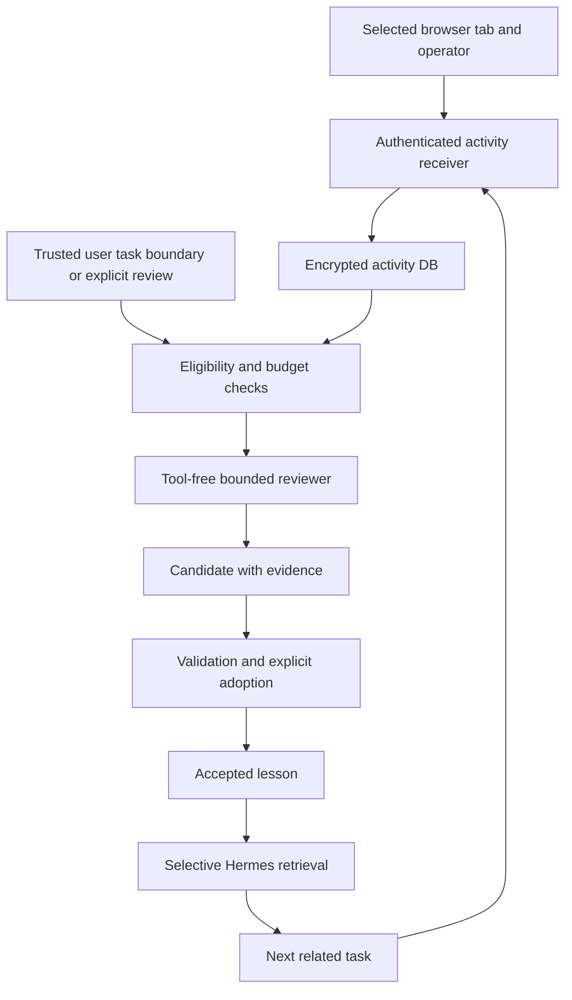

# Browser activity and conditional learning for Mordred

Status: proposed architecture, revised after the Fable review of 2026-10-19.

## Purpose and selected design

Help Hermes repeat fewer browser-operation mistakes by retaining relevant
experience, extracting evidence-backed improvement candidates, and retrieving
accepted lessons during later related work. Success means better task outcomes
without making unrelated conversations less accurate or introducing unattended
LLM spending. This is improvement through retrieval and reusable procedures;
it does not train or change model weights.

Implement the feature in the existing `mordred` plugin distribution and
`mordred-browser-os-oparator`, including its extension. Keep Hermes core files
unchanged. Use a Mordred-owned encrypted database, short lifecycle callbacks,
an optional tool-free reviewer, and two bundled skills. No cron job is required.

The selected storage path is
`<profile-home>/plugin-data/mordred/activity.db`. This deliberately revises the
earlier proposal to add browser-history tables to the physical `state.db` file.
Hermes still uses the experience through the Mordred plugin; sharing a database
file is not required for that integration.

| Approach | Benefit | Cost or limitation | Decision |
|---|---|---|---|
| Dedicated encrypted activity DB | Independent schema, retention and recovery; no interference with conversation repair | Mordred must own its backup and restore contract | Selected |
| Namespaced tables inside `state.db` | One physical ledger | Hermes recovery does not copy arbitrary tables; repair and replaced-file handling need integration | Alternative only if the physical-file requirement is reinstated |
| Append history to MEMORY or skills immediately | Simple recall | Unverified observations become persistent instructions; poor scope and rollback | Rejected |

The first delivery covers selected, authorized browser tabs, operator actions,
explicit corrections, and accepted-lesson retrieval. It does not claim complete
capture of every browser interaction, private page, or action while disconnected.
Broader collection and durable client outboxes are separate increments.

## Baseline and compatibility

The design is grounded in Hermes checkout `5fc490e2b3`, Mordred checkout
`8d4f7aebd`, and browser operator checkout `a7492b2`. The inspected Mordred
development environment contains Hermes 0.19.0. The checkout and installed
package are different compatibility targets; version strings alone do not
identify the running source.

Relevant observed behavior:

- Hermes recovery copies an allowlist of tables, although ordinary whole-file
  database backups preserve additional tables.
- SQLCipher protection in Mordred is currently macOS-only and separately
  enabled. Logs, screenshots and ordinary text files are not covered by it.
- Operator `after_action` reports dispatch results, not independently verified
  completion of the user's goal. Rejection can occur before that callback.
- `post_llm_call` does not cover interrupted turns. `on_session_end` is emitted
  after a conversation call, rather than only when a user closes a session.
- Hermes 0.19.0 exposes `ctx.llm.complete_structured`, but its implementation
  calls the auxiliary client with `task=None`. `purpose` is an audit label.
  The newer checkout supports task routing. Registering an auxiliary task alone
  therefore does not select that task on every supported runtime.
- Host-side JSON schema validation can be skipped when an optional dependency
  is absent. Mordred must validate review output itself.
- Context supplied by a hook may persist as `api_content` and be replayed.
  Oversized hook output can spill into plaintext files.

Enable capabilities only after behavior tests against the actual runtime and
module locations. Add consumed hook fields to `tools/hook_payload_contract.json`
and the hook reference when implementation adopts them. In particular, do not
require the newer `failed` or exit-reason fields on 0.19.0, or infer a trusted
human origin merely from `session_id` or `platform`.

The existing [imported-message provenance proposal](2026-10-19-imported-message-provenance-design.md)
is separate work. Browser history must preserve its source restrictions, but
this feature does not implement or depend on that proposal's archive adapters.

## Components and responsibilities

| Component | Responsibility | Must not do |
|---|---|---|
| Operator and extension collectors | Emit attributed, bounded action and observation events | Declare a task successful from an agent's final text |
| Authenticated receiver | Bind peer to profile, validate, redact, deduplicate and acknowledge durable writes | Trust a profile path or approval supplied by page content |
| Activity store | Own schema, episode revisions, jobs, candidates, lessons and usage records | Insert browser events into Hermes `messages` as live instructions |
| Boundary coordinator | Track trusted interaction identity and admit eligible jobs | Start work on every hook, browser event, timer or app shutdown |
| Review worker | Request structured candidates using a bounded evidence snapshot | Invoke tools, operate the browser, write memory or adopt its output |
| Adoption service | Validate evidence, scope and user authorization; version lessons | Treat model confidence as approval |
| Retrieval adapter | Return applicable accepted lessons with provenance and limits | Return candidates or raw event bodies to ordinary action sessions |
| Skills | Describe when to recall and how to assess experience | Enforce scheduling, access control, budgets or authorization |

Add an `activity` component under `src/mordred_hermes/`, registered by the
existing `mordred` entry point. Use focused modules for contracts, storage,
ingestion, episodes, scheduling, review, adoption, retrieval and commands.
Reuse existing encryption, pairing, privacy and provider guards rather than
creating independent versions. Do not introduce a second plugin identity.

## Capture and event contract

Collection is off until enabled for a profile and paired browser/operator.
The initial scope is the selected tab or explicitly selected task. Supported
events include navigation, click, submit, non-sensitive field interaction,
operator dispatch, cancellation, timeout, task boundary, correction and outcome
observation. Human DOM events are observations of interaction, not proof that
the site's business operation succeeded. Sites with unsupported frames, canvas
interactions or other gaps expose incomplete coverage.

Exclude incognito/private contexts, password and payment fields, credentials,
cookies, authorization headers, arbitrary keystroke streams, full page bodies,
and screenshots in the first delivery. Strip URL query strings and fragments;
normalize paths to allowed route patterns. Treat target labels and titles as
untrusted text, bound them, and omit them where source policy disallows capture.
No LLM call is used to sanitize each event. If safe extraction is uncertain,
omit the content and record a content-free exclusion reason.

Each event has the following logical fields:

| Group | Fields and meaning |
|---|---|
| Identity | `schema_version`, `event_id`, receiver-bound `peer_id`, producer instance ID and monotonically increasing producer sequence |
| Correlation | `episode_id`, `attempt_id`, optional Hermes session/turn reference, optional operator run reference |
| Attribution | `source` such as browser/operator/Hermes/user correction; actor type human/agent/unknown; source trust and permitted-use class |
| Time | Producer observation time and receiver ingestion time; ordering uses producer sequence and receiver order, not wall-clock trust |
| Action | Typed operation, redacted target description, normalized site/route, safe arguments and causal parent reference |
| Phase | `intended`, `dispatched`, `observed`, `cancelled` or `timed_out` |
| Result | `unknown`, `claimed_success`, `claimed_failure`, `verified_success` or `verified_failure`, plus verification method and evidence references |
| Quality | Coverage, exclusions, truncation and before/after page signatures when safely available |

Create a unique `attempt_id` before each proposed execution, including rejected
and retried actions. Each phase has its own stable event ID. Replaying the same
event preserves its ID; retrying an action gets a new attempt ID and references
the previous attempt. A run ID plus successful step count is not sufficient.
Agent and browser observations of one action are correlated, not counted as two
independent successes. Missing correlation remains explicit.

Only the receiver and designated verifier can set authoritative ownership,
adoption or verification fields. A paired collector proves the event's transport
origin, not the truth of page text. A page change may verify navigation without
verifying a purchase, message delivery or completed business task. A timeout
remains unknown unless separate evidence resolves it. Model `done` text remains
a claim. Never repeat a potentially consequential action merely to verify it.

Corrections refer to a specific attempt or lesson when possible. An explicit
correction control can produce a deterministic candidate without an LLM. Natural
language that only appears to be a correction is a review signal, not an
authenticated preference or automatic approval. Historic instructions are
reference data; current user instructions and current application state prevail.

## Authenticated ingestion and delivery

Extend the authenticated Mordred extension API with a versioned activity-batch
message and response. Operator-originated events require their own paired peer
credential, scoped to activity submission and revocable independently of wallet
or chat permissions. Reuse pairing infrastructure; the unauthenticated CDP
`/extension` relay is not an activity writer. An extension ID or localhost origin
alone is insufficient authentication.

The receiver maps the authenticated principal to a trusted profile scope and
collection policy. Peer-supplied home paths, owner labels and policy values are
ignored. A pairing change invalidates pending authorization. Profile switches
must not replay an old profile's buffer into the new profile.

Start with batches of at most 100 events, 4 KiB of normalized data per event,
and 256 KiB per batch. Reject malformed, conflicting or oversized batches before
writing. In a single transaction, validate dedupe keys, append new events,
advance the episode revision, and commit. Return durable ACKs only after commit.
An existing ID with identical canonical content is acknowledged without a second
insert; the same ID with different content is a conflict and is not overwritten.
Lost ACKs are handled by resending the original batch.

The first collector uses a bounded memory buffer only: at most 256 events or
1 MiB, whichever is reached first. It does not put raw payloads in browser
storage, disk queues or logs. Overflow, disconnect and producer restart expose
a recording gap; a reconnect never asserts continuous coverage. Events not yet
acknowledged can be lost on restart. Acknowledged events must survive receiver
restart. This is durable server acceptance with idempotent retries, not guaranteed
delivery of every observed browser event.

If complete offline delivery becomes a requirement, add an encrypted client
outbox as a separate delivery, with reviewed key custody, rotation and deletion.
Do not give the extension Hermes's database or memory encryption key. Recording
failure must not silently block or re-execute the user's browser action.

## Database and encryption lifecycle

Use the profile-aware plugin storage convention, with a compatible storage
adapter where the installed runtime lacks the current helper. Resolve the
owning home at each entry point; worker state and connection ownership are keyed
by that home. No process-global default home or environment fallback is allowed
for a queued job. Store the profile binding in DB metadata and verify it before
reading or writing.

The following tables are proposed, all in `activity.db`:

| Table | Main contents and constraints |
|---|---|
| `activity_meta` | Schema version, profile binding and store generation |
| `activity_events` | Append-only normalized events; unique peer/event ID and producer sequence; episode/time indexes |
| `activity_episodes` | Task scope, trusted correlation, revision, coverage and observed outcome |
| `activity_review_jobs` | Immutable input snapshot references, episode revision, reviewer/prompt version, state and lease |
| `activity_review_attempts` | Physical request identity, reservation, provider/model, usage, completion certainty and failure code |
| `activity_lessons` | Candidate or accepted revision, applicability, counterconditions, evidence, validation and adoption record |
| `activity_lesson_evidence` | Links to the exact source events/revisions; deletion and supersession dependencies |
| `activity_uses` | Lesson revision retrieved, later selected/applied if observed, task reference and independent outcome |
| `activity_budget` | Atomic per-profile reservations and rolling usage totals |

Keep search indexes inside the same encrypted file. Begin with scope and
structured-field filtering plus bounded text search; embeddings and external
vector stores are unnecessary. Japanese and English search require behavior
fixtures before claiming support. A search miss is not proof that an event did
not happen.

The collector requires all of: supported platform, active encryption marker,
healthy key and runtime protection, no pending conversion conflict, and a
successful keyed open of this store. Verify the new store itself, not only a
cached filesystem scan. Failure or uncertainty disables activity persistence
and reading; there is no plaintext fallback. The existing monitor's lenient
warning path, or its returning no warning after an exception, is not sufficient.

Use the existing dbcrypt lifecycle lease and SQLite safety choices. Do not force
WAL on a runtime where the host selects a safer journal mode. Keep connections
and transactions short. Database busy, disk-full and migration failures produce
bounded refusals and content-free status, not retries inside a foreground hook.
Schema migrations run under exclusive activity-store ownership, with an encrypted
snapshot, version check and rollback procedure. A newer unsupported schema is
refused rather than recreated.

Mordred owns an explicit backup/restore command for this store and verifies
inclusion in supported whole-home Hermes backups. Use consistent encrypted
SQLite snapshots, not a live file copy that drops the WAL. Test keys, indexes,
job state and lesson dependencies after restore. `sessions recover` is not the
activity recovery command. Restoring a DB resets leases and classifies uncertain
requests; it must not automatically start model calls or replay browser actions.
Dangling Hermes session references are marked unavailable and never rebound to
another conversation after state recovery.

Default retention is 30 days for ordinary raw events and 90 days for unadopted
candidates and their evidence. Accepted lessons retain the minimum redacted
evidence needed to audit them until revoked or deleted. Pin the referenced
redacted event records before ordinary retention removes unrelated data; if the
required evidence cannot be retained, suspend the dependent lesson. Retention work is a
bounded DB operation on ingestion or an explicit maintenance command, with no
LLM or timer requirement. A full store rejects new capture with visible status;
it never silently deletes accepted evidence to make room.

Deletion invalidates dependent lessons and queued snapshots in one transaction.
Review output whose evidence was removed before commit is discarded. Recheck
source eligibility before retrieval and adoption. Logical deletion does not
erase copies in old encrypted backups, existing conversation transcripts or
provider systems; the deletion UI states this scope. Do not promise secure
physical erasure from SQLite pages. Stop writers and use the established
encrypted-store maintenance procedure when physical compaction is requested.

## Review eligibility and execution

Recording and marking eligibility use ordinary code. A job is eligible only
when there is an unreviewed episode revision and a meaningful signal: an explicit
correction, a verified failure followed by recovery, or a procedure demonstrated
in multiple distinct completed episodes. Elapsed time or event count alone does
not justify a review. Review results, recalled lessons and reviewer calls cannot
create a new learning episode or count as independent evidence.

| Trigger | Permitted behavior |
|---|---|
| Browser event or browser-only task completion | Persist and update eligibility; no review LLM call |
| Trusted interactive Hermes turn ends | Enqueue eligible snapshot; consider one review only under the foreground admission contract |
| Next interactive use of Hermes | Reconcile pending jobs using code; consider work after its foreground turn completes |
| Explicit activity review command | Review the selected eligible scope under the configured budget |
| Session finalize, reset, process shutdown | Flush bounded state, revoke launch permits and leave remaining work pending |
| Cron, subagent, native background review, this reviewer, timer tick | No automatic activity-review admission |

Use `on_session_end` as a completion observation, not as proof of task success,
human origin, UI delivery or idle time. `post_llm_call` can supplement correlation
but is not the sole lifecycle trigger. Hooks copy small identifiers to a bounded
queue and return; they never query large histories or call a model. Recover a
missed eligibility notification from durable episodes at the next interaction.

Automatic admission requires a trusted interaction registry owned by the
Mordred surface: profile, human request ID, task/turn link, active foreground
count and shutdown state. The surface grants a single-use launch permit only
after its foreground response delivery and dispatch have completed. New input
or shutdown revokes unused permits. Hooks alone do not provide that guarantee.
Surfaces without this contract support capture and explicit review, with
automatic review unavailable rather than guessed from hook names.

There is one review worker per profile with a DB lease preventing another
process from claiming the same job. Bind profile and secret scope explicitly
when crossing a thread or process boundary. A new foreground request prevents
new model submissions and requests cancellation of a running one when supported.
It does not wait for cancellation. An already submitted request may still finish
and incur cost; it may save a candidate but cannot affect the running task.

Jobs progress through `pending -> leased -> calling -> completed`, with
`deferred`, `failed` and `uncertain` states. The uniqueness key is the episode
ID, input revision and reviewer/prompt version. Freeze evidence before calling;
later events create a new revision, not a moving input to the existing job.
Commit output, validated evidence references and known usage atomically.

Before each physical provider attempt, reserve budget and persist its identity.
After a crash, a lease without a submitted request can be reclaimed. A request
that might have reached the provider becomes `uncertain`; it is not automatically
resubmitted in the first version. An explicit retry records another attempt.
Use provider idempotency only where its contract supports this request type.
Candidate commits are idempotent; exactly-once external billing is not promised.

## Tool-free review and cost control

The worker supplies the review instructions and a bounded, redacted episode
snapshot to `ctx.llm.complete_structured`. It does not instantiate a general
Hermes agent, clone the conversation or call the private native review fork.
There are no browser, terminal, memory, skill-write or delegation tools.

The structured result includes `decision` (candidate/no-change/insufficient
evidence), an explanation, the proposed lesson, scope, exceptions, evidence IDs
and a verification proposal. The worker checks the schema itself, field sizes,
allowed enums, evidence membership, source permissions and episode revision.
Reject unknown IDs and requests to widen permissions. Valid JSON and model
confidence do not establish that a lesson is correct. Invalid output consumes
the attempt budget and does not trigger an automatic repair conversation.

Route policy is explicit. On a verified task-capable host, register
`mordred_activity_review` and pass the supported `task` argument. On 0.19.0,
use an explicitly configured provider/model through the host's permitted
override policy, or leave LLM review unavailable. Do not silently inherit an
unrelated or more expensive default, and do not treat `purpose` as routing.
Confirm the actual provider/model and Mordred auxiliary guards at request time;
prohibited or unpriced automatic routes fail closed. No direct SDK bypass.

Proposed pilot defaults, stored under `plugins.mordred_activity` in the owning
profile's `config.yaml`, are:

| Setting | Initial value or rule |
|---|---|
| Feature | Disabled until configured; no existing profile is silently enrolled |
| Collection | Selected authorized tabs/tasks; encryption required |
| Review mode | `manual`; `task_boundary` is an explicit option on capable surfaces |
| Automatic review concurrency | One per profile |
| Physical provider attempts | At most one automatic attempt per job and two total attempts per rolling 24 hours; explicit retries also count |
| Review request size | At most 6,000 input tokens and 1,000 output tokens, including instructions |
| Timeout | 30 seconds per request; no waiting for it in the foreground |
| Automatic spacing | At least 30 minutes; checked on a new eligible interaction, never a wake timer |
| Paid automatic budget | Must be explicitly set; absent means no paid automatic calls |
| Recall | Tool-driven accepted lessons; automatic pre-call insertion disabled |
| Recall limits | Three items, 1,000 tokens and 4 KiB per response; 2,000 new activity-reference tokens per session |
| Promotion | Explicit user adoption; no autonomous MEMORY, USER or skill editing |

Treat these as proposed ceilings, not performance measurements. Token and byte
limits both apply, including envelopes. Reservations cover configured output
maximums and every transport retry/fallback. Require a verified path to bound
host/SDK retries before enabling automatic review; one facade invocation does
not necessarily equal one billable call. Unknown usage retains its reservation
until reconciled and is never recorded as zero cost. Price estimates are labeled
as estimates and do not claim to match the provider invoice.

## Candidate adoption and self-improvement

Lessons have immutable revisions and the states `candidate`, `validated`,
`admitted`, `suspended`, `rejected` and `retired`. Validation records an
independent check, not the reviewer's own assessment. Adoption is an explicit
authenticated user operation over the exact revision, scope and evidence digest.
Model text, historical approval text or a page cannot authorize it. Editing a
candidate after review invalidates the old validation/adoption record.

The first version permits local, reversible procedural guidance and explicit
preferences within the approved task/site/account scope. Repeated behavior
alone does not establish a user preference. Exclude security-policy changes,
credential handling, expansion of tool permissions, and automatic authorization
of payments, messages, purchases or destructive actions.

Each admitted lesson states when it applies, when it does not, what to check
before using it, and how success is measured. Site structure and account identity
are checked afresh. A stale selector or changed page signature causes abstention;
do not turn yesterday's DOM location into a permanent action command.

The loop is:

1. Record an attributed action, its observed result and an explicit correction.
2. Create a narrow deterministic candidate, or generate one with the optional
   bounded reviewer at an eligible boundary.
3. Validate the evidence and procedure in a fixture, harmless read-only check,
   or explicit user confirmation appropriate to the claim; record which method.
4. Let the user adopt that specific revision and scope.
5. Retrieve it for a matching later task, check its conditions and use the
   current user's request as the authority for any action.
6. Record retrieval separately from observed application and outcome. A successful
   task does not prove that retrieval caused the success.
7. Suspend a lesson when the user contradicts it or an independent check shows
   it is stale. Generate a new candidate for changes; do not silently rewrite
   an admitted revision.

Example: a user says a browser workflow should use the account switcher before
opening reports. The correction links to that attempt. The candidate names the
site and account scope and requires checking the visible account indicator.
After validation and adoption, a related report task can retrieve the lesson.
The next task's independent account check and the need for another correction
measure usefulness. A report task on another site gets no result.

MEMORY.md, USER.md and native skills retain their existing Hermes lifecycle.
This feature does not create a `User.db` or write these files during adoption.
A future export to memory or a generated procedural skill needs its own reviewed
diff and approval, with activation in a later session to preserve prompt caching.

## Retrieval and interaction with native learning

Register two service-gated plugin tools at session setup:
`mordred_activity_search` and `mordred_activity_get`. Their ordinary-agent
contract exposes only admitted lesson revisions and a minimal approved evidence
summary. Search accepts task/site/account scope; detail rechecks eligibility
and scope rather than trusting an ID returned earlier. Neither tool accepts
arbitrary SQL, profile paths, an adoption flag or a switch to raw candidates.

The `activity-recall` skill tells Hermes to search for a relevant prior correction,
a resumed workflow, or a repeated failure; verify scope and present conditions;
and abstain on conflicts. Start with explicit requests and task-related skill
selection. Automatic selective injection is a later optimization requiring
measured benefit. Skill availability makes retrieval possible; it does not
guarantee that a model will choose it at the right moment.

The `activity-review` skill defines the evidence checklist and the user-facing
explicit review workflow. The worker uses a versioned copy of those instructions
as data, without launching the skill in a tool-enabled agent. Scheduling and
adoption remain program-controlled.

Raw history and candidates are available through an authenticated administrative
viewer and the isolated review worker. CLI status prints identifiers, counts and
states; it opens that viewer for raw inspection instead of returning private
records to a terminal tool. Adoption and raw inspection require a separate
current user-authenticated interaction, not the collector's write credential or
an agent-supplied confirmation flag. The normal Hermes retrieval tools cannot
return unadmitted records, even if requested by a prompt. A future raw-history question
answering surface must provide a separately verified protected reader contract;
the earlier provenance proposal does not make that contract available today.

This separation prevents the feature from feeding unadmitted candidates to
Hermes's native background reviewer. A text prefix saying “do not learn this” is
not the enforcement mechanism. Ordinary user corrections already present in a
conversation can still participate in Hermes's existing memory behavior; the
feature does not claim to stop that independent process. Admitted material may
also be summarized by native facilities.

Suspension prevents new activity retrieval, including stale detail requests,
but does not erase already-exposed conversation context or independently saved
native memories/skills. Record exposure so affected sessions can be identified.
Offer an explicit cleanup/reset workflow for known persistent copies; until
dependency tracking covers those paths, do not promise universal rollback.

Tool schemas, system prompt bytes and loaded memory snapshots remain stable for
the conversation. Service availability is fixed at setup; runtime revocation
causes a handler refusal, not removal of a tool schema. Returned lessons are
ordinary bounded tool results with revision IDs and source labels. Repeated
retrieval deduplicates content across tools and turns. Count transcript replay
in evaluation; references are not free merely because no review LLM was called.
Exceeding the session budget returns a short limit status, not a spill file or
a larger context block. Changes to tool availability take effect next session.
Stopping collection, revoking a peer or disabling review immediately refuses
new work without altering the current tool schema.

## Privacy and failure behavior

Inherit the most restrictive source policy. A private messaging page cannot be
used to bypass Mordred's message privacy policy by collecting it as browser
history. Refuse capture for disallowed or tainted sources. Normal action-session
recall is limited to explicitly admitted minimal guidance; sensitive evidence
stays in its protected reader/reviewer context. Model allowlists and permitted
destinations apply before any evidence leaves the process.

Disable or redact collector debug payloads, operator logs, screenshots, relay
traces, request dumps and review errors along the protected collection path.
If an operation necessarily creates an uncontrolled plaintext artifact, that
operation is outside protected capture and the UI shows the limitation. Do not
claim that encrypting `activity.db` retroactively protects existing artifacts.
Audit only identifiers, counts, classified failures and usage; do not include
page content or credentials in status, metrics or exception text.

On store, pairing, encryption or model-policy failure, skip/refuse the activity
operation and expose a content-free status. Preserve unrelated foreground
Hermes behavior unless the existing global Mordred policy itself requires a
stop. Do not weaken that global policy to keep recording. Capture, review and
recall can be disabled independently; disabling review does not delete records.

These boundaries cover Mordred-controlled collectors, tools, viewers and model
requests. They are not an OS sandbox against arbitrary same-user programs that
already possess the encryption key or unrestricted filesystem access. Do not
advertise prompt labels, hidden CLI commands or plugin guards as such a sandbox.

## Acceptance criteria

Release evidence must separate deterministic contracts, live encryption checks
and actual-model evaluations. Use isolated homes, synthetic accounts and page
fixtures. No production browsing history is needed for these tests.

| Area | Required evidence |
|---|---|
| Event fidelity | Rejection records cancellation without execution; timeout remains unknown; model completion remains claimed; verifier results carry exact evidence |
| Dedupe and coverage | Lost-ACK replay inserts once; conflicting payload is refused; retries have distinct attempt IDs; restart/overflow exposes gaps; committed events survive restart |
| Ownership | Peers cannot target an unpaired profile or forge another peer's identity, including worker thread hops and re-pairing; intentional aggregation within the same profile remains possible |
| Encryption | Native macOS checks show unreadable row data through unkeyed SQLite for DB and backups; key loss, unarmed state, scan failure and unsupported platform cause no plaintext creation |
| Plaintext copies | Sensitive fixture strings do not appear in collector logs, screenshots, traces, browser disk queues, hook spill files or error output |
| Recovery | Backup/restore preserves records and dependencies; migration rollback works; Hermes state repair/recovery does not damage activity storage; unresolved references stay unresolved |
| Lifecycle | Browser-only use, cron, subagents, shutdown and timers submit zero activity-review requests; only trusted interactive boundaries or explicit commands admit work |
| Foreground | Target less than 20 ms p95 hook overhead on the declared benchmark host; locked DB/model delays never cause a foreground wait for the review; overflow is bounded and observable |
| Budget | Concurrent processes respect reservations; all transport attempts count; missing prices or unknown usage cannot become unlimited/zero-cost automatic work |
| Crash recovery | No duplicate candidate commit; potentially submitted requests become uncertain; no automatic replay of a charge or browser action |
| Review validation | Missing schema dependency does not skip Mordred validation; forged evidence IDs, changed revisions, disallowed scopes and deleted sources are refused |
| Native learning | Through the feature's supported interfaces, unique fixture data present only in unadmitted events/candidates never enters ordinary Hermes prompts or native memory/skill outputs, including CLI status, compression, resume and background review |
| Recall and caching | No cross-scope or suspended results; response/session bounds hold; tool schemas and system prompt remain unchanged across turns; no unbounded repeated lesson content |
| Adoption | Only authenticated user adoption changes a validated revision to admitted; forged or replayed approval for a changed revision fails |
| Outcome measurement | Retrieval, application and outcome are separate; page-state assertions/user feedback establish success, not the reviewer's confidence |

For the pilot, use a fixed benchmark of at least 30 tasks: 10 with a relevant
prior correction, 10 unrelated tasks, and 10 conflicting, stale or adversarial
history cases. Run each condition three times with the same model/version,
settings and fixtures, comparing feature off, recording only, and admitted-lesson
recall. Establish answerability and success assertions before generating lessons;
hold out evaluation variants to avoid grading on the examples used to create them.

Pilot acceptance requires at least a 20% relative reduction in repeated
correction errors on related tasks, no lower observed success count on unrelated
tasks, zero forbidden executed actions, and zero cross-profile or unadmitted-data
exposures. If the baseline has no correction errors, that fixture set cannot
demonstrate improvement and must be replaced. Publish task counts, paired results,
latency, tokens and uncertainty; this small pilot is a release gate, not proof
that accuracy can never regress. Live provider evaluations are separately opt-in
and budgeted. Missing or skipped runs are not passing evidence.

## Delivery sequence and scope boundaries

1. **Contracts and recording:** authenticate collectors, define action phases,
   create the encrypted store and verify backup/recovery, profile isolation,
   artifact handling and visible recording gaps. No review LLM calls.
2. **One correction loop:** create deterministic candidates from explicit linked
   corrections; add validation/adoption UI or CLI, bounded lesson tools and the
   recall skill. Prove improvement and unrelated-task behavior.
3. **Conditional review:** add durable jobs, exact runtime routing, tool-free
   review, budget accounting and explicit review. Enable automatic boundary
   review only on surfaces with the foreground admission contract.
4. **Measured expansion:** consider selective context insertion, more collectors,
   encrypted offline outboxes or explicit skill export only after each proves
   benefit and preserves the earlier contracts.

At integration, reconcile `docs/dev/SPEC.md`, `PLAN.md`, `TODO.md`, `PATHS.md`,
`CI.md` and the hook contract without renaming existing headings. Follow each
repository's test runner and native acceptance requirements. This proposal adds
no product code, production settings, database conversion or scheduled job.

If the original same-physical-`state.db` requirement is retained, substitute a
separately reviewed storage design that handles the recovery allowlist,
exclusive repair, quarantine, replaced-file guards and restore tests. Merely
documenting possible history loss is not equivalent to this design's persistence
contract. No Hermes core modification is assumed to solve that alternative.

## Implementation references

- [Mordred database protection](../../dev/STATE_DB_ENCRYPTION.md),
  [upstream boundary](../../dev/UPSTREAM.md), and
  [hook contract](../../dev/HOOK_PAYLOADS.md).
- [Mordred plugin registration](../../../src/mordred_hermes/plugin.py),
  [authenticated extension API](../../../src/mordred_hermes/extension/api.py),
  [encryption checks](../../../src/mordred_hermes/dbcrypt/_hooks.py), and
  [auxiliary request guard](../../../src/mordred_hermes/llm_guard/auxiliary_guard.py).
- [Hermes recovery allowlist](../../../../hermes-agent/hermes_cli/session_recovery.py),
  [plugin storage](../../../../hermes-agent/plugins/plugin_storage.py),
  [public plugin LLM facade](../../../../hermes-agent/agent/plugin_llm.py),
  [turn finalization](../../../../hermes-agent/agent/turn_finalizer.py), and
  [hook output spill](../../../../hermes-agent/tools/hook_output_spill.py).
- [Operator actions](../../../../mordred-browser-os-oparator/src/mordred/fara_runner.py)
  and [CDP relay](../../../../mordred-browser-os-oparator/src/mordred/cdp_relay.py).

Sibling-checkout links are navigation aids for this workspace. The recorded
baseline and runtime capability tests govern compatibility after those checkouts
move; local source paths are not a supported production API.
